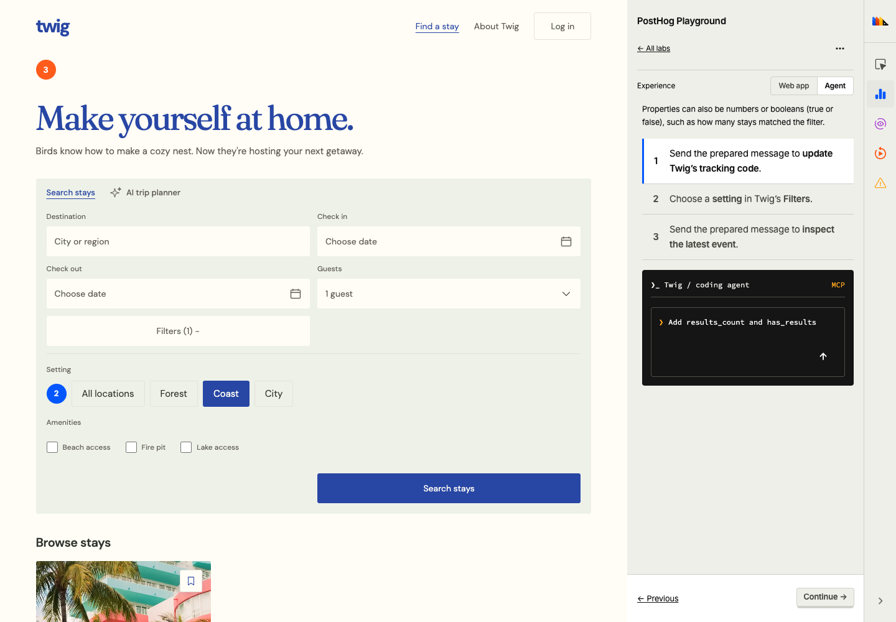
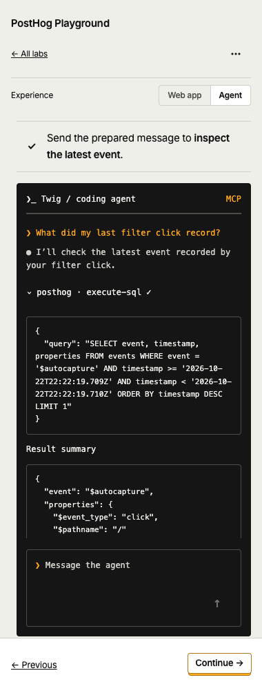
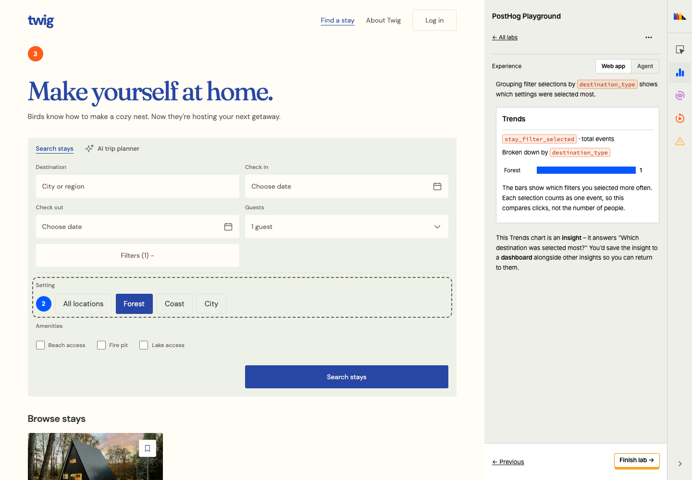
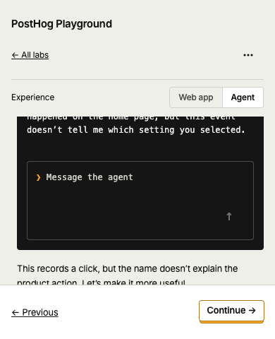
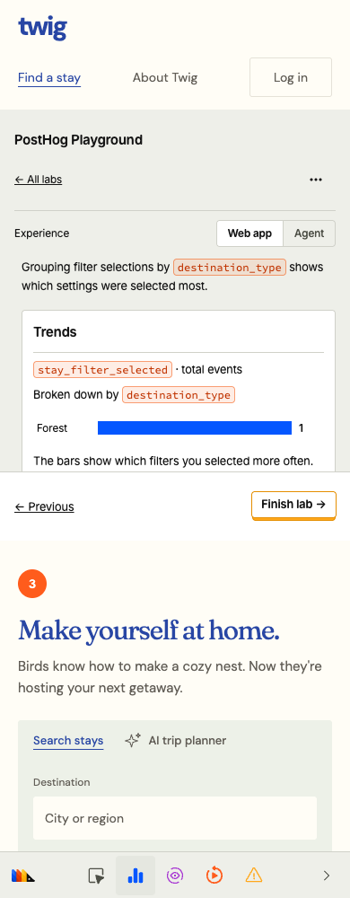

# Events and properties review

Captured on Twig.com with the locally packed component branch at 1440 × 900 and 390 × 844. These screenshots show local teaching events, not a connected PostHog project.

| Entry | Agent | Trends |
| --- | --- | --- |
|  |  |  |
| |  |  |

## Shared control refinement

The refreshed Agent images above come from actual Twig.com. Additional actual-site code, Wizard, and expanded tool-call screenshots are in the companion Twig PR. The Playground controls workbench covers [desktop](playground-controls-1440.png), [390px](playground-controls-390.png), and [320px](playground-controls-320.png): connected blue radio choices, shared highlighted code, Wizard commands, and the plain-arrow local MCP composer. No external inference or production analytics was used.
